

  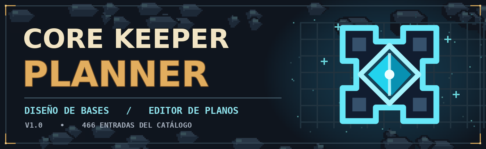

  **Construye tu hogar subterráneo antes de colocar el primer bloque.**

  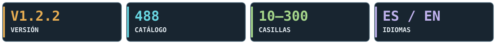

  [🇬🇧 English](README.md) · **🇪🇸 Español**

  [Características](#caracteristicas) · [Catálogo](#catalogo) · [Editor](#editor) · [Compartir](#compartir) · [Atajos](#atajos) · [Créditos](#creditos)

> **Última versión — v1.1.1:** rellena áreas conectadas con suelos u objetos del catálogo, añade alcances para la selección rectangular, permite editar, mover, borrar y girar notas, y corrige un error que podía borrar los bloques de color al hacer clic en una nota. [Descargar el HTML autónomo](https://github.com/kraventD/Core-Keeper-Planner/releases/download/v1.1.1/core-keeper-planner-1.1.1.html) · [Descargar el ZIP](https://github.com/kraventD/Core-Keeper-Planner/releases/download/v1.1.1/core-keeper-planner-1.1.1.zip).

La numeración de versiones sigue la política del proyecto en [VERSIONING.md](VERSIONING.md).

## 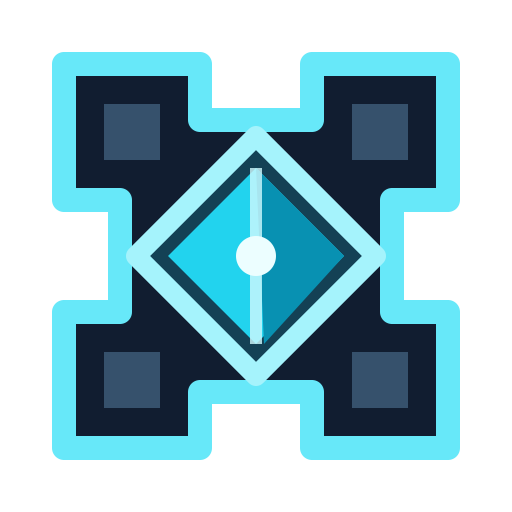 ¿Qué es Core Keeper Planner?

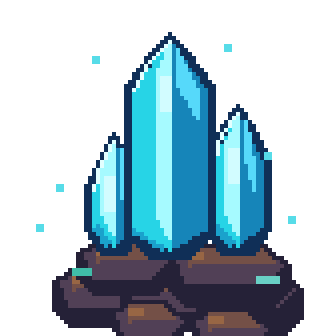

**Core Keeper Planner** es una herramienta visual no oficial para diseñar y planificar bases de [Core Keeper](https://core-keeper.fandom.com/wiki/Core_Keeper_Wiki). Traza habitaciones, organiza estaciones de trabajo, planifica granjas, coloca muebles y decora tu hogar subterráneo sobre una cuadrícula casilla por casilla.

Combina un editor flexible, un amplio catálogo y planos compartibles para transformar tus ideas en diseños que puedas construir antes de empezar a recolectar materiales en el juego.

  <a href="assets/readme/editor-dark.png">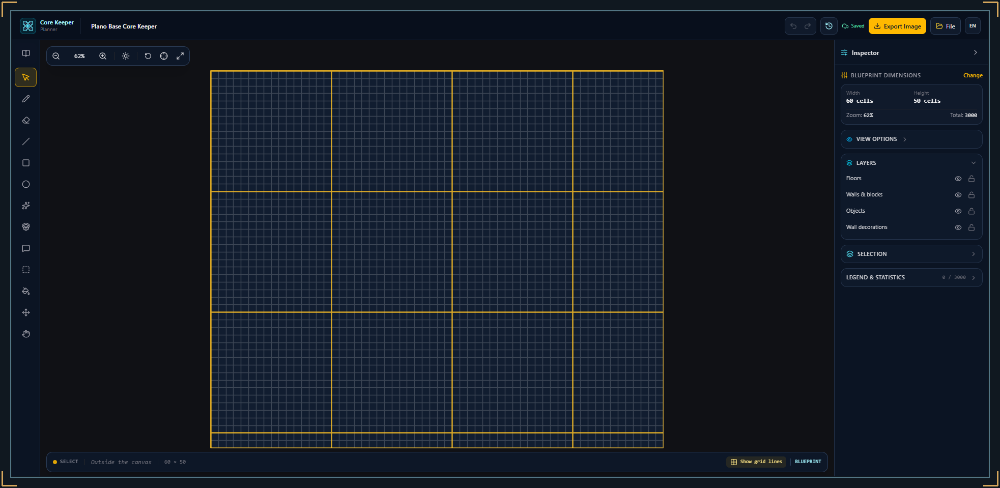</a>
  <em>El editor: una vista casilla por casilla de tu próxima base.</em>

## 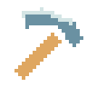 Características 

<table>
  <tr>
    <td width="50%" valign="top">
      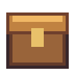 
      <strong>488 entradas del catálogo</strong> 
      Explora materiales, suelos, muebles, estaciones y naturaleza. Busca en ambos idiomas y guarda favoritos.
    </td>
    <td width="50%" valign="top">
       
      <strong>Herramientas de dibujo precisas</strong> 
      Dibuja, borra, rellena, refleja, selecciona y mueve diseños con precisión de casilla.
    </td>
  </tr>
  <tr>
    <td valign="top">
       
      <strong>Capas independientes</strong> 
      Organiza suelos, paredes, objetos y decoraciones de pared sin sobrescribir las otras capas.
    </td>
    <td valign="top">
       
      <strong>Lienzo personalizable</strong> 
      Construye en cuadrículas de 10 × 10 a 300 × 300 casillas, con guía del centro activada y guías opcionales de chunks e iluminación.
    </td>
  </tr>
  <tr>
    <td valign="top">
       
      <strong>Guarda y comparte</strong> 
      Recupera respaldos locales, guarda proyectos, intercambia códigos de texto y exporta planos PNG.
    </td>
    <td valign="top">
       
      <strong>Flujo de trabajo rápido</strong> 
      Usa atajos, historial de 50 pasos para deshacer y rehacer, rotación de objetos y transformaciones de selección.
    </td>
  </tr>
</table>

##  Catálogo 

<table>
  <tr>
    <td valign="top" width="68%">
      <strong>Todo lo que necesitas para organizar una base.</strong>
      
El catálogo de la v1.1 reúne <strong>488 entradas únicas seleccionables</strong>, organizadas en cuatro secciones.

      <ul>
        <li>Busca por nombre en español o inglés.</li>
        <li>Guarda favoritos localmente en el navegador.</li>
        <li>Filtra objetos por tamaño o capa.</li>
        <li>Filtra suelos y elementos de naturaleza por tipo, incluidos cultivos, plantas y árboles.</li>
      </ul>
    </td>
    <td align="center" valign="top">
      <a href="assets/readme/catalog.png">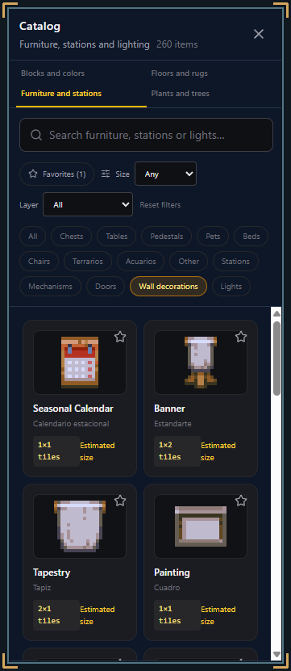</a>
    </td>
  </tr>
</table>

| Categoría | Entradas | Qué incluye |
| :--- | ---: | :--- |
| 🧱 Bloques y colores | **65** | 27 paredes, 8 puentes, 6 cercas, 1 riel y 23 bloques representados con colores |
| 🟫 Suelos y alfombras | **62** | Suelos construidos, baldosas, alfombras, tapetes y terrenos del juego |
| 🛠️ Muebles y estaciones | **260** | Cofres, mesas, pedestales, camas, sillas, mecanismos, puertas, iluminación, estaciones y decoraciones de pared |
| 🌱 Plantas y árboles | **101** | 44 entradas de cultivos, incluidas las variantes en maceta, 25 árboles y 32 plantas u otros elementos de naturaleza |
| **Total** | **488** | Entradas únicas seleccionables |

> **Estado del catálogo:** la cifra cuenta entradas seleccionables, no cada sprite individual ni cada etapa visual. La versión 1.1 todavía no incluye todos los objetos del juego.

Los colores de paredes y bloques siguen los valores publicados en la wiki de Core Keeper cuando están disponibles. Si falta un valor, se utiliza un color representativo basado en el tono predominante del sprite y se marca como estimado.

##  Editor 

### Dibujo y construcción

| Herramienta | Qué permite hacer |
| :--- | :--- |
| Lápiz / borrador | Pintar con un pincel de 1 × 1 a 20 × 20 casillas. Una opción del borrador también permite eliminar objetos y suelos. |
| Línea | Dibujar una línea entre dos puntos |
| Rectángulo | Dibujar un contorno o rectángulo relleno |
| Círculo | Dibujar un contorno o círculo relleno, desde el centro o una esquina |
| Rellenar área | Rellenar una región conectada con el color, suelo u objeto activo del catálogo |
| Espejo en tiempo real | Reflejar trazos de lápiz, borrador, línea, rectángulo y círculo horizontalmente, verticalmente o en cuatro direcciones |
| Colocar Core | Insertar el patrón del Core y las estatuas, añadir opcionalmente un punto de teletransporte y centrar el patrón en el plano |
| Anotación | Agregar, editar, girar, mover o borrar notas |
| Selección rectangular / mover selección | Seleccionar todo, solo suelos o solo objetos; copiar, mover o borrar el contenido elegido |
| Seleccionar | Seleccionar y mover objetos colocados |
| Mano | Desplazar la vista del lienzo |

El elemento activo del catálogo aparece sobre el lienzo junto a los iconos de sus herramientas compatibles.

<table>
  <tr>
    <td align="center" width="50%"><a href="assets/readme/tool-options.png">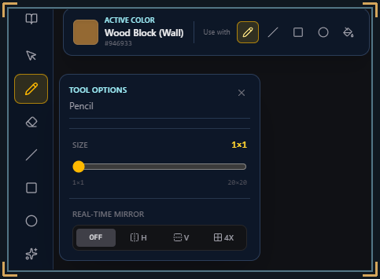</a> Opciones de herramientas y espejo</td>
    <td align="center" width="50%"><a href="assets/readme/core-placement.png">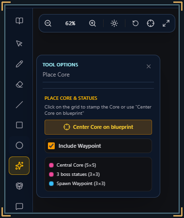</a> Colocación del Core</td>
  </tr>
</table>

###  Capas y objetos

Cada casilla admite cuatro capas de construcción independientes:

| Capa | Contenido |
| :--- | :--- |
| 1. Suelos | Terrenos, suelos y superficies relacionadas |
| 2. Paredes y bloques | Paredes y materiales de construcción, incluidos los representados con colores |
| 3. Objetos | Muebles, estaciones, alfombras y otros objetos colocables |
| 4. Decoraciones de pared | Decoraciones que requieren una pared detrás |

Muestra, oculta, bloquea o desbloquea cada capa de forma independiente. Por ejemplo, puedes colocar una alfombra sobre un suelo sin eliminar el suelo que hay debajo.

- Los objetos utilizan su huella de colocación en casillas, que puede superar 1 × 1; los sprites pueden extenderse visualmente más allá de esa huella.
- Los sprites altos conservan su altura visual tanto en el editor como en las exportaciones PNG.
- Mueve, gira en cuatro orientaciones, copia, corta, pega o elimina los objetos seleccionados. Cada objeto conserva su propia orientación.
- Selecciona una zona para copiar, cortar, pegar, rellenar, borrar, mover, duplicar reflejada, voltear horizontal o verticalmente, o centrar en uno o ambos ejes.
- Los avisos de colocación indican objetos fuera del plano, espacios ocupados en la misma capa, falta de una pared detrás y capas de destino ocultas o bloqueadas.
- La iluminación puede mostrar una cobertura aproximada; las luces compatibles también permiten ajustar su alcance.

  <a href="assets/readme/selection-edit.png">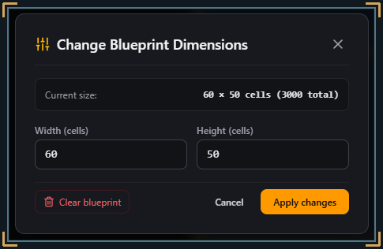</a> 
  Edición y transformaciones de selección

###  Plano y visualización

- Crea un plano con nombre, ancho y alto independientes entre **10 y 300 casillas**.
- Elige una cuadrícula de fondo claro u oscuro al crear o editar el plano.
- Acerca o aleja la vista, restablece el zoom, centra el plano o ajústalo a la pantalla.
- Desplaza la vista con la herramienta mano, la rueda o el botón central del ratón; usa Espacio + arrastre para navegar rápidamente.
- Muestra u oculta la cuadrícula, regula su contraste y elige entre tres grosores de línea.
- La guía del centro para diseños simétricos está visible por defecto; las guías de chunks y de cobertura aproximada de luces empiezan ocultas y pueden activarse en las opciones de vista.
- El lienzo vuelve a centrar el plano automáticamente al cambiar el tamaño de la ventana.

<table>
  <tr>
    <td align="center" width="50%"><a href="assets/readme/new-plan.png">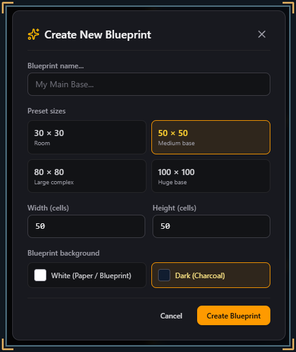</a> Crear un plano personalizado</td>
    <td align="center" width="50%"><a href="assets/readme/view-options.png">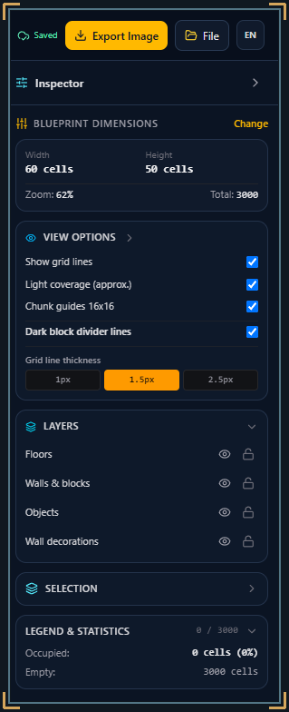</a> Opciones de visualización y capas</td>
  </tr>
</table>

  <a href="assets/readme/editor-light.png">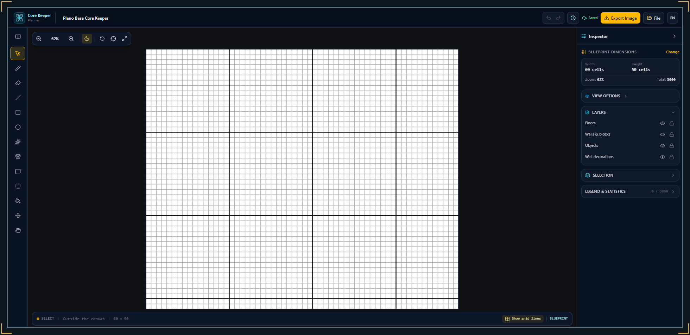</a> 
  El mismo espacio de planificación, con cuadrícula clara.

##  Compartir 

Tus diseños están hechos para guardarse, perfeccionarse y compartirse.

| Función | Detalles |
| :--- | :--- |
| Archivos de proyecto | Crea, abre y guarda un proyecto como archivo |
| Autoguardado local | Conserva el progreso en el navegador y recupera un respaldo anterior |
| Deshacer y rehacer | Hasta 50 pasos en el historial |
| Códigos de diseño | Exporta un código de texto e impórtalo para cargar un plano |
| Exportación PNG | Elige escala, fondo oscuro, azul, claro o transparente y visibilidad de la cuadrícula |
| Leyenda de exportación | Incluye colores y objetos colocados con sus nombres, huellas y cantidades |

<table>
  <tr>
    <td align="center" width="50%"><a href="assets/readme/file-menu.png">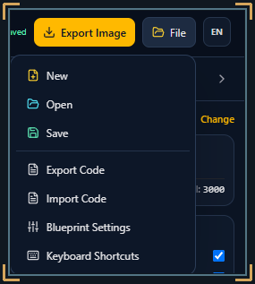</a> Administración de proyectos</td>
    <td align="center" width="50%"><a href="assets/readme/png-export.png">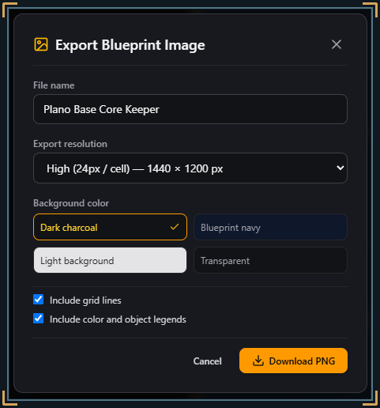</a> Opciones de exportación PNG</td>
  </tr>
</table>

  <a href="assets/readme/share-code.png">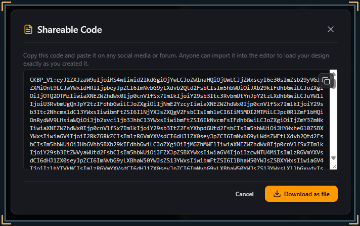</a> 
  Comparte un plano completo mediante un código de texto.

## 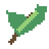 De la idea al hogar subterráneo

Comienza con un lienzo vacío, dibuja tus habitaciones, añade suelos y paredes y complétalas con estaciones de trabajo, almacenamiento, cultivos y decoraciones.

  <a href="assets/readme/base-example.png">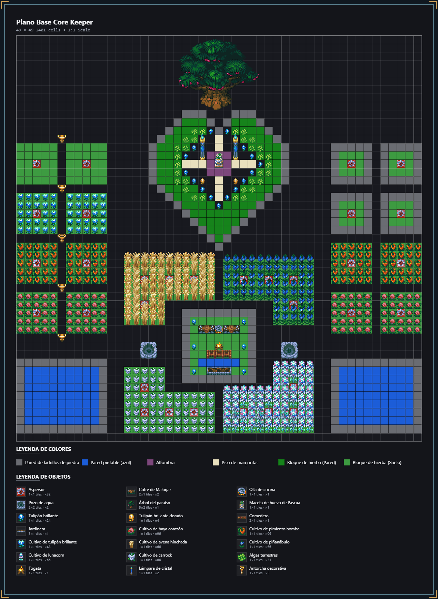</a> 
  <strong>Ejemplo de base exportada desde Core Keeper Planner.</strong> 
  Haz clic en la imagen para explorar el diseño a resolución completa.

##  Atajos 

La interfaz está disponible en **español e inglés**.

| Tecla | Acción | Tecla | Acción |
| :--- | :--- | :--- | :--- |
| `P` | Lápiz | `E` | Borrador |
| `L` | Línea | `R` | Rectángulo |
| `C` | Círculo | `B` / `G` | Rellenar área |
| `S` | Selección rectangular | `M` | Mover selección |
| `K` | Colocar Core | `V` | Seleccionar |
| `Ctrl+C` | Copiar | `Ctrl+X` | Cortar |
| `Ctrl+V` | Pegar | `Ctrl+Z` | Deshacer |
| `Ctrl+Y` | Rehacer | `[` / `]` | Girar objeto seleccionado |
| Rueda del ratón | Zoom | Espacio + arrastre | Desplazar vista |

  
<strong>Ver el panel de atajos de la aplicación</strong>

  
<a href="assets/readme/keyboard-shortcuts.png">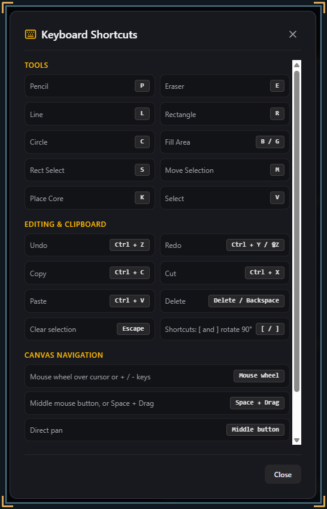</a>

##  Créditos 

- **Core Keeper** — el juego que inspira este proyecto y del que proceden muchos sprites y referencias visuales.
- [**Core Keeper Wiki**](https://core-keeper.fandom.com/wiki/Core_Keeper_Wiki) — información del catálogo, valores de color y otras referencias visuales.
- **Core Keeper Planner** — herramienta de planificación independiente, creada por aficionados para la comunidad de Core Keeper.

Core Keeper Planner es un proyecto independiente que desarrollo y mantengo personalmente. No está afiliado, patrocinado ni respaldado por los desarrolladores o distribuidores de Core Keeper. Los recursos del juego y sus marcas pertenecen a sus respectivos titulares. Esta es una herramienta de planificación; los códigos compartidos no importan directamente una base al juego.

  
   
  <strong>Planifica. Construye. Hazlo tuyo.</strong>
   
  CORE KEEPER PLANNER · VERSIÓN 1.1.1
   
  <a href="README.md">Read in English</a>

