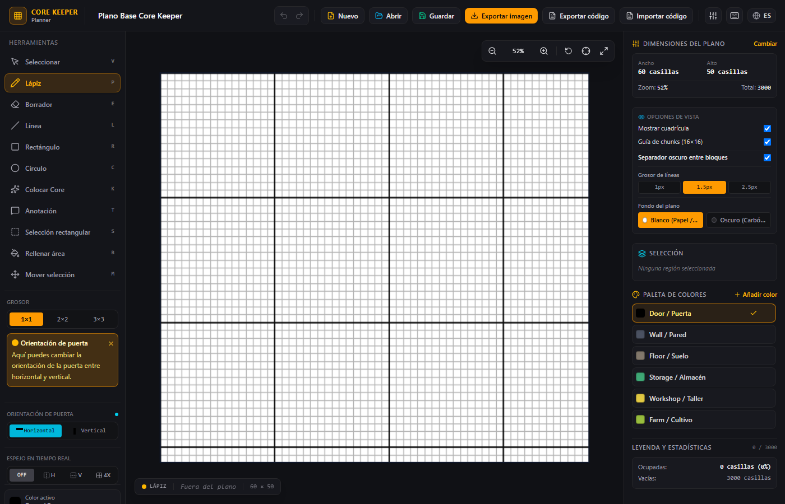

# Core Keeper Planner / Planificador de Planos Core Keeper

English | [Español](#español)

---

## English

Design room and base blueprints for **Core Keeper** on a 1:1 grid. No installation, no internet, no registration.

### What is it?

**Core Keeper Planner** is a blueprint editor for the game Core Keeper. It lets you draw rooms, corridors, storage, and structures on a grid, exactly as they appear in the game.

Ideal for planning your base before building it in the game, sharing designs with the community, or saving templates to reuse.

### Key Features

| Feature | Description |
|---------|-------------|
| **Cell-based drawing** | Pencil, eraser, line, rectangle, and circle (walls or fill) |
| **Core placement** | Official Core and statues pattern with one click |
| **Selection and movement** | Select regions, move them, flip them, mirror them, center them |
| **Annotations** | Add text notes directly on the blueprint |
| **Color palette** | Create and edit your own custom colors |
| **Export PNG** | Download an image of your blueprint to share on Reddit, Facebook, etc. |
| **Shareable code** | Generate a text code that anyone can import to load your design |
| **Bilingual** | Interface in Spanish and English |

### How to use (3 steps)

1. **Download** the `.zip` file from [Releases](https://github.com/kraventD/Core-Keeper-Planner/releases)
2. **Extract** it to any folder on your computer
3. **Open** `index.html` with your browser (Chrome, Edge, Brave, or Firefox)

Ready. You can start drawing your blueprint.

> [!WARNING]
> **Don't want to unzip anything?** Download the standalone `.html` file from [Releases](https://github.com/kraventD/Core-Keeper-Planner/releases) and open it directly in your browser.

### Requirements

- Any computer with Windows, Mac, or Linux
- Modern web browser (Chrome, Edge, Brave, Firefox)
- **No installation needed**
- **No internet connection required** (works 100% offline)

### Screenshot

### How to share your designs

1. Design your blueprint in the editor
2. Click **Export Code** to copy a shareable text code
3. Paste that code on Reddit, Facebook, Discord, or any forum
4. Another person pastes the code into their editor and loads your design exactly as you created it

You can also export to **PNG** to share a visual image of your blueprint.

### Quick keyboard shortcuts

| Key | Action |
|-----|--------|
| `V` | Select |
| `P` | Pencil |
| `E` | Eraser |
| `L` | Line |
| `R` | Rectangle |
| `C` | Circle |
| `K` | Place Core |
| `S` | Rect Select |
| `B` / `G` | Fill Area |
| `M` | Move Selection |
| `T` | Annotation |
| `1-9` | Select palette color |
| `+` / `-` | Zoom In / Zoom out |
| `Space` | Pan canvas |
| `Ctrl+Z` / `Ctrl+Y` | Undo / Redo |

### Support

Made for the Core Keeper community. If you find a bug or have a suggestion, open an issue on GitHub.

---

## Español

Diseña planos de habitaciones y bases para **Core Keeper** en una cuadrícula 1:1. Sin instalación, sin internet, sin registro.

### ¿Qué es?

**Core Keeper Planner** es un editor de planos (blueprint editor) para el juego Core Keeper. Te permite dibujar habitaciones, pasillos, almacenes y estructuras sobre una cuadrícula, exactamente como se ven en el juego.

Ideal para planear tu base antes de construirla en el juego, compartir diseños con la comunidad o guardar plantillas para reutilizar.

### Características principales

| Característica | Descripción |
|---------------|-------------|
| **Dibujo por celdas** | Lápiz, borrador, línea, rectángulo y círculo (muros o relleno) |
| **Colocación de Core** | Patrón oficial del Core y estatuas con un clic |
| **Selección y movimiento** | Selecciona regiones, muévelas, volvealas, espejéalas y céntralas |
| **Anotaciones** | Agrega notas de texto directamente sobre el plano |
| **Paleta de colores** | Crea y edita tus propios colores personalizados |
| **Exportar PNG** | Descarga una imagen de tu plano para compartir en Reddit, Facebook, etc. |
| **Código compartible** | Genera un código de texto que cualquiera puede importar para cargar tu diseño |
| **Bilingüe** | Interfaz en español e inglés |

### Cómo usarlo (3 pasos)

1. **Descarga** el archivo `.zip` desde [Releases](https://github.com/kraventD/Core-Keeper-Planner/releases)
2. **Descomprímelo** en cualquier carpeta de tu computadora
3. **Abre** `index.html` con tu navegador (Chrome, Edge, Brave o Firefox)

Listo. Ya puedes empezar a dibujar tu plano.

> [!WARNING]
> **¿No quieres descomprimir nada?** Descarga el archivo `.html` independiente desde [Releases](https://github.com/kraventD/Core-Keeper-Planner/releases) y ábrelo directamente en tu navegador.

### Requisitos

- Cualquier computadora con Windows, Mac o Linux
- Navegador web moderno (Chrome, Edge, Brave, Firefox)
- **No necesitas instalar nada**
- **No necesitas conexión a internet** (funciona 100% offline)

### Captura

### Cómo compartir tus diseños

1. Diseña tu plano en el editor
2. Haz clic en **Exportar código** para copiar un texto compartible
3. Pega ese texto en Reddit, Facebook, Discord o cualquier foro
4. Otra persona pega el código en su editor y carga tu diseño exactamente como lo creaste

También puedes exportar a **PNG** para compartir una imagen visual de tu plano.

### Atajos de teclado rápidos

| Tecla | Acción |
|-------|--------|
| `V` | Seleccionar |
| `P` | Lápiz |
| `E` | Borrador |
| `L` | Línea |
| `R` | Rectángulo |
| `C` | Círculo |
| `K` | Colocar Core |
| `S` | Selección rectangular |
| `B` / `G` | Rellenar área |
| `M` | Mover selección |
| `T` | Anotación |
| `1-9` | Seleccionar color de paleta |
| `+` / `-` | Acercar / Alejar zoom |
| `Espacio` | Mover el lienzo |
| `Ctrl+Z` / `Ctrl+Y` | Deshacer / Rehacer |

### Soporte

Hecho para la comunidad de Core Keeper. Si encuentras un error o tienes una sugerencia, abre un issue en GitHub.

---

*Core Keeper Planner - Planificador de construcción y habitaciones 1:1*
