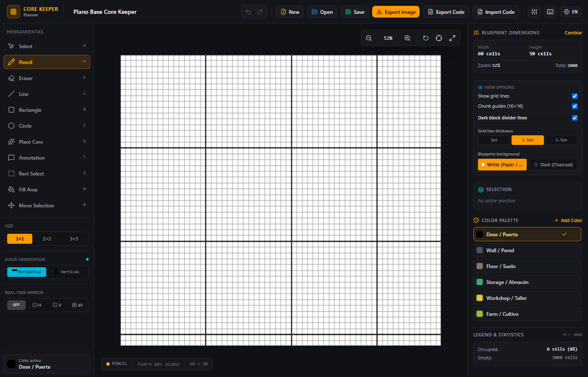
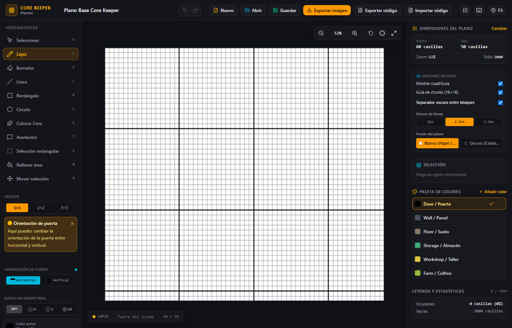

# Core Keeper Planner / Planificador de Planos Core Keeper

English | [Español](#español)

---

## English

Design room and base blueprints for **Core Keeper** on a 1:1 grid. No installation, no internet, no registration.

### What is it?

**Core Keeper Planner** is a blueprint editor for the game Core Keeper. It lets you draw rooms, corridors, storage, and structures on a grid, exactly as they appear in the game.

Ideal for planning your base before building it in the game, sharing designs with the community, or saving templates to reuse.

### What's new in v0.1.8

- **Plants, trees, and crops:** a dedicated nature section adds placeable plants and trees, with crop stages and tile dimensions so larger sprites keep their correct footprint and height.
- **Objects edit with selections:** rectangular selection and move now include placed objects; copy, cut, paste, and delete work with selected objects as well as colored cells.
- **More accurate object rendering:** sprites are drawn using their actual height and tile footprint, including pillars and Crystal Lamp.
- **Complete PNG exports:** exports now include placed objects and, when the legend is enabled, an object legend alongside the color legend. The legend lists localized names, tile footprints, and counts.
- **Reliable offline downloads:** the release ZIP contains an autonomous `index.html` that opens directly after extraction, and the standalone HTML can be opened without extracting a ZIP. Both include the required app code and game assets and work offline.
- **Building on v0.1.6:** the release keeps the simplified color-based construction palette, grouped object catalog, per-door orientation, selected-material drawing tools, and corrected and expanded object sprites introduced earlier.

### The road to v1.0.0

Core Keeper Planner is approaching **v1.0.0**. The next milestone is to keep checking item sizes and in-game appearance, polish editing and export, and address community feedback before calling the planner stable.

#### v0.1.6 catalog screenshots

### Key Features

| Feature | Description |
|---------|-------------|
| **Grid drawing tools** | Paint, erase, draw lines, rectangles and circles, and fill connected areas using the currently selected material |
| **Construction colors** | Place walls, blocks, floors, bridges, fences, rails, mats and rugs as color-coded cells; Wiki colors are used where available and estimates are labeled |
| **Object catalog** | Browse furniture, stations, lighting, plants, trees and crops with sprites and tile-size information |
| **Object placement** | Place, select, move, copy, paste and rotate catalog items; door orientation is saved independently for every door |
| **Core placement** | Add the Core and its starting statues with one click |
| **Region editing** | Select, move, duplicate, flip, mirror and center parts of a blueprint |
| **Annotations** | Add editable text notes directly on the blueprint |
| **Plan controls** | Set blueprint dimensions and adjust zoom, grid, chunk guides, light coverage, line width and canvas background |
| **Save and share** | Save and reopen project files, export or import a shareable code, and export PNG images with placed objects and legends |
| **Bilingual** | Interface in Spanish and English |

### How to use (3 steps)

1. **Download** the `.zip` file from [Releases](https://github.com/kraventD/Core-Keeper-Planner/releases)
2. **Extract** it to any folder on your computer
3. **Open** `index.html` with your browser (Chrome, Edge, Brave, or Firefox)

Ready. You can start drawing your blueprint.

> [!WARNING]
> **Don't want to unzip anything?** Download the standalone `.html` file from [Releases](https://github.com/kraventD/Core-Keeper-Planner/releases) and open it directly in your browser.

The ZIP's `index.html` is also autonomous: extract it and open the file directly. No installation or setup is needed.

### Requirements

- Any computer with Windows, Mac, or Linux
- Modern web browser (Chrome, Edge, Brave, Firefox)
- **No installation needed**
- **No internet connection required** (works 100% offline)

### Screenshot

### How to share your designs

1. Design your blueprint in the editor
2. Click **Export Code** to copy a shareable text code
3. Paste that code on Reddit, Facebook, Discord, or any forum
4. Another person pastes the code into their editor and loads your design exactly as you created it

You can also export to **PNG** to share a visual image of your blueprint.

### Quick keyboard shortcuts

| Key | Action |
|-----|--------|
| `V` | Select |
| `P` | Pencil |
| `E` | Eraser |
| `L` | Line |
| `R` | Rectangle |
| `C` | Circle |
| `K` | Place Core |
| `S` | Rect Select |
| `B` / `G` | Fill Area |
| `M` | Move Selection |
| `T` | Annotation |
| `1-9` | Select palette color |
| `+` / `-` | Zoom In / Zoom out |
| `Space` | Pan canvas |
| `Ctrl+Z` / `Ctrl+Y` | Undo / Redo |

### Support

Made for the Core Keeper community. If you find a bug or have a suggestion, open an issue on GitHub.

---

## Español

Diseña planos de habitaciones y bases para **Core Keeper** en una cuadrícula 1:1. Sin instalación, sin internet, sin registro.

### ¿Qué es?

**Core Keeper Planner** es un editor de planos (blueprint editor) para el juego Core Keeper. Te permite dibujar habitaciones, pasillos, almacenes y estructuras sobre una cuadrícula, exactamente como se ven en el juego.

Ideal para planear tu base antes de construirla en el juego, compartir diseños con la comunidad o guardar plantillas para reutilizar.

### Novedades de la v0.1.8

- **Plantas, árboles y cultivos:** una nueva categoría reúne plantas y árboles colocables e incluye cultivos con sus etapas y dimensiones en tiles para representar correctamente los sprites grandes.
- **Objetos incluidos en la selección:** la selección rectangular y su movimiento ahora abarcan objetos colocados; copiar, cortar, pegar y eliminar también operan sobre ellos junto con las casillas de color.
- **Representación más precisa:** los sprites respetan su altura real y su huella en tiles, incluidos los pilares y la Lámpara de cristal.
- **Exportación PNG completa:** las imágenes exportadas ahora muestran los objetos colocados y, al activar la leyenda, añaden una leyenda de objetos junto a la de colores con nombres traducidos, huella en tiles y cantidad.
- **Descargas autónomas y sin conexión:** el ZIP incluye un `index.html` autónomo que se abre directamente después de extraerlo; también se ofrece un HTML independiente. Ambos incluyen el código y los recursos necesarios y funcionan sin conexión.
- **Continuidad de la v0.1.6:** se conserva la paleta simplificada de construcción por colores, el catálogo agrupado, la orientación individual de cada puerta, las herramientas vinculadas al elemento seleccionado y los sprites ampliados y corregidos.

### Camino hacia la v1.0.0

El proyecto se acerca a la **v1.0.0**. El siguiente objetivo es seguir revisando tamaños y apariencia de los objetos, pulir la edición y la exportación e incorporar comentarios de la comunidad antes de declarar estable el planner.

#### Capturas del catálogo v0.1.6

### Características principales

| Característica | Descripción |
|---------------|-------------|
| **Herramientas de dibujo en cuadrícula** | Pintar, borrar, trazar líneas, rectángulos y círculos, y rellenar áreas conectadas con el material seleccionado |
| **Colores de construcción** | Representar paredes, bloques, suelos, puentes, cercas, rieles, tapetes y alfombras con colores; los colores de la wiki se usan cuando existen y las estimaciones se identifican |
| **Catálogo de objetos** | Explorar muebles, estaciones, iluminación, plantas, árboles y cultivos con sprites y dimensiones en tiles |
| **Colocación de objetos** | Colocar, seleccionar, mover, copiar, pegar y girar objetos; cada puerta conserva su propia orientación |
| **Colocación del Core** | Agregar el Core y sus estatuas iniciales con un clic |
| **Edición de regiones** | Seleccionar, mover, duplicar, voltear, espejear y centrar partes del plano |
| **Anotaciones** | Agregar y editar notas de texto directamente sobre el plano |
| **Controles del plano** | Definir dimensiones y ajustar zoom, cuadrícula, guía de chunks, cobertura de luz, grosor de línea y fondo |
| **Guardar y compartir** | Guardar y abrir proyectos, exportar o importar códigos compartibles y generar PNG con objetos y leyendas |
| **Bilingüe** | Interfaz en español e inglés |

### Cómo usarlo (3 pasos)

1. **Descarga** el archivo `.zip` desde [Releases](https://github.com/kraventD/Core-Keeper-Planner/releases)
2. **Descomprímelo** en cualquier carpeta de tu computadora
3. **Abre** `index.html` con tu navegador (Chrome, Edge, Brave o Firefox)

Listo. Ya puedes empezar a dibujar tu plano.

> [!WARNING]
> **¿No quieres descomprimir nada?** Descarga el archivo `.html` independiente desde [Releases](https://github.com/kraventD/Core-Keeper-Planner/releases) y ábrelo directamente en tu navegador.

El `index.html` del ZIP también es autónomo: extráelo y ábrelo directamente. No requiere instalación ni configuración.

### Requisitos

- Cualquier computadora con Windows, Mac o Linux
- Navegador web moderno (Chrome, Edge, Brave, Firefox)
- **No necesitas instalar nada**
- **No necesitas conexión a internet** (funciona 100% offline)

### Captura

### Cómo compartir tus diseños

1. Diseña tu plano en el editor
2. Haz clic en **Exportar código** para copiar un texto compartible
3. Pega ese texto en Reddit, Facebook, Discord o cualquier foro
4. Otra persona pega el código en su editor y carga tu diseño exactamente como lo creaste

También puedes exportar a **PNG** para compartir una imagen visual de tu plano.

### Atajos de teclado rápidos

| Tecla | Acción |
|-------|--------|
| `V` | Seleccionar |
| `P` | Lápiz |
| `E` | Borrador |
| `L` | Línea |
| `R` | Rectángulo |
| `C` | Círculo |
| `K` | Colocar Core |
| `S` | Selección rectangular |
| `B` / `G` | Rellenar área |
| `M` | Mover selección |
| `T` | Anotación |
| `1-9` | Seleccionar color de paleta |
| `+` / `-` | Acercar / Alejar zoom |
| `Espacio` | Mover el lienzo |
| `Ctrl+Z` / `Ctrl+Y` | Deshacer / Rehacer |

### Soporte

Hecho para la comunidad de Core Keeper. Si encuentras un error o tienes una sugerencia, abre un issue en GitHub.

---

*Core Keeper Planner - Planificador de construcción y habitaciones 1:1*
