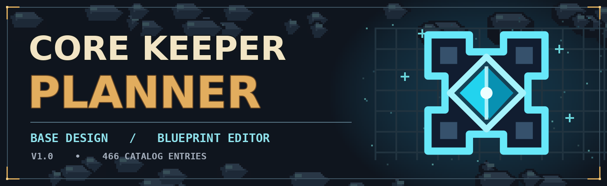
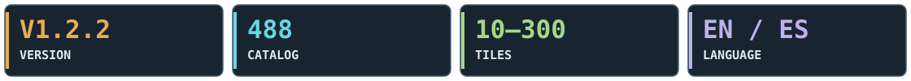
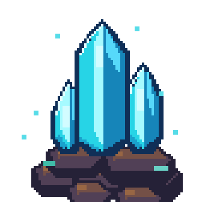
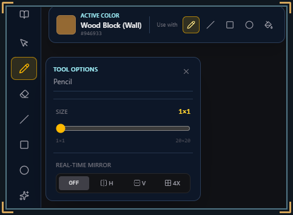
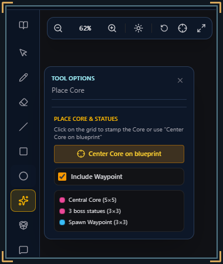
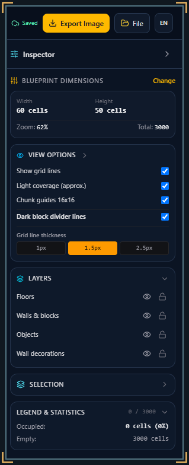
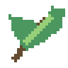

  

  **Build your underground home before you place the first block.**

  

  **🇬🇧 English** · [🇪🇸 Español](README.es.md)

  [Features](#features) · [Catalog](#catalog) · [Editor](#editor) · [Sharing](#sharing) · [Shortcuts](#shortcuts) · [Credits](#credits)

> **Latest release — v1.2.0:** adds five-minute recovery history with thumbnails, clearer mirrored selection previews, cursor-following paste previews with collision warnings, and faster note editing. [Download the standalone HTML](https://github.com/kraventD/Core-Keeper-Planner/releases/download/v1.2.0/core-keeper-planner-1.2.0.html) · [Download the ZIP](https://github.com/kraventD/Core-Keeper-Planner/releases/download/v1.2.0/core-keeper-planner-1.2.0.zip).

> **Try it online:** [Open Core Keeper Planner](https://kraventd.github.io/Core-Keeper-Planner/). Plans are saved in this browser; use the import and export tools to move them between devices.

Release numbering follows the project policy in [VERSIONING.md](VERSIONING.md).

##  What is Core Keeper Planner?

**Core Keeper Planner** is an unofficial visual planning tool for designing bases in [Core Keeper](https://core-keeper.fandom.com/wiki/Core_Keeper_Wiki). Sketch rooms, organize crafting stations, plan farms, place furniture and decorate your underground home on a tile-by-tile grid.

Combine a flexible editor, an extensive catalog and shareable blueprints to turn ideas into buildable layouts before you start collecting materials in the game.

  
  <em>The editor — a tile-by-tile view of your next base.</em>

##  Features 

<table>
  <tr>
    <td width="50%" valign="top">
       
      <strong>488 catalog entries</strong> 
      Browse building materials, floors, furniture, stations and nature. Search in either language and save favorites.
    </td>
    <td width="50%" valign="top">
       
      <strong>Precise drawing tools</strong> 
      Draw, erase, fill, mirror, select and move layouts with tile-level precision.
    </td>
  </tr>
  <tr>
    <td valign="top">
       
      <strong>Independent layers</strong> 
      Organize floors, walls, objects and wall decorations without overwriting other layers.
    </td>
    <td valign="top">
       
      <strong>Customizable canvas</strong> 
      Build on grids from 10 × 10 to 300 × 300 tiles, with a center guide enabled by default and optional chunk and light guides.
    </td>
  </tr>
  <tr>
    <td valign="top">
       
      <strong>Save and share</strong> 
      Recover local backups, save project files, exchange text codes and export illustrated PNG plans.
    </td>
    <td valign="top">
       
      <strong>Faster workflows</strong> 
      Use keyboard shortcuts, 50-step undo/redo history, object rotation and selection transformations.
    </td>
  </tr>
</table>

##  Catalog 

<table>
  <tr>
    <td valign="top" width="68%">
      <strong>Everything you need to organize a base.</strong>
      
The v1.1 catalog brings together <strong>488 unique selectable entries</strong>, organized into four sections.

      <ul>
        <li>Search by English or Spanish name.</li>
        <li>Save favorites locally in your browser.</li>
        <li>Filter objects by size or layer.</li>
        <li>Filter floors and nature by type, including crops, plants and trees.</li>
      </ul>
    </td>
    <td align="center" valign="top">
      
    </td>
  </tr>
</table>

| Category | Entries | Includes |
| :--- | ---: | :--- |
| 🧱 Blocks & colors | **65** | 27 walls, 8 bridges, 6 fences, 1 rail and 23 color-represented blocks |
| 🟫 Floors & rugs | **62** | Crafted flooring, tiles, carpets, mats and in-game terrain |
| 🛠️ Furniture & stations | **260** | Chests, workbenches, pedestals, beds, chairs, mechanisms, doors, lighting, stations and wall decorations |
| 🌱 Plants & trees | **101** | 44 crop entries including potted variants, 25 trees and 32 other plants or nature elements |
| **Total** | **488** | Unique selectable catalog entries |

> **Catalog status:** the count refers to selectable entries, not individual sprites or visual stages. Version 1.1 does not yet include every item in the game.

Wall and block colors follow values published on the Core Keeper Wiki when available. Missing values are represented using an estimated dominant sprite color and are marked as estimated.

##  Editor 

### Drawing and construction

| Tool | What it does |
| :--- | :--- |
| Pencil / eraser | Paint with a brush from 1 × 1 to 20 × 20 tiles. An eraser option can also remove objects and floors. |
| Line | Draw a line between two points |
| Rectangle | Draw an outline or a filled rectangle |
| Circle | Draw an outline or a filled circle, starting from the center or a corner |
| Area fill | Fill a connected region with the active color, floor or catalog object |
| Real-time mirror | Mirror pencil, eraser, line, rectangle and circle strokes horizontally, vertically or in four directions |
| Place Core | Insert the Core and statue pattern, optionally include a teleport point and center the pattern in the plan |
| Annotation | Add, edit, rotate, move or delete notes |
| Rectangle selection / move selection | Select all contents, floors only or objects only; copy, move or delete the selected scope |
| Select | Select and move placed objects |
| Hand | Pan around the canvas |

The active catalog item appears above the canvas alongside icons for its compatible tools.

<table>
  <tr>
    <td align="center" width="50%"> Tool and mirror options</td>
    <td align="center" width="50%"> Core placement</td>
  </tr>
</table>

###  Layers and objects

Every tile supports four independent construction layers:

| Layer | Contents |
| :--- | :--- |
| 1. Floors | Terrain, floors and related surfaces |
| 2. Walls & blocks | Walls and other building materials, including color-represented blocks |
| 3. Objects | Furniture, stations, rugs and other placed objects |
| 4. Wall decorations | Decorations that require a wall behind them |

Show, hide, lock or unlock each layer independently. For example, place a rug over a floor without removing the floor beneath it.

- Objects use their actual tile footprint, which can extend beyond a single tile; sprites may extend visually beyond that footprint.
- Tall object sprites preserve their visual height in both the editor and PNG exports.
- Move, rotate in four directions, copy, cut, paste or delete selected objects. Each object retains its own orientation.
- Select an area to copy, cut, paste, fill, erase, move, create a mirrored duplicate, flip horizontally or vertically, or center it on either or both axes.
- Placement warnings flag objects extending outside the plan, overlaps on the same layer, missing backing walls and hidden or locked target layers.
- Lighting objects can visualize approximate coverage; supported lights also allow range adjustments.

   
  Selection editing and transformations

###  Canvas and viewing controls

- Create a named plan with independent width and height, each between **10 and 300 tiles**.
- Choose a light or dark grid while creating or editing a plan.
- Zoom in and out, reset zoom, center the plan or fit it to the screen.
- Pan with the hand tool, mouse wheel or middle mouse button; use Space + drag for quick navigation.
- Show or hide grid lines, adjust their contrast and select one of three line thicknesses.
- Keep the blueprint center guide visible by default for symmetric layouts; chunk and approximate light coverage guides start hidden and can be enabled in view options.
- The canvas automatically recenters the plan when the window is resized.

<table>
  <tr>
    <td align="center" width="50%"> Create a custom plan</td>
    <td align="center" width="50%"> View and layer settings</td>
  </tr>
</table>

   
  The same planning workspace, with a light grid.

##  Sharing 

Your designs are made to be kept, refined and shared.

| Function | Details |
| :--- | :--- |
| Project files | Create, open and save a project as a file |
| Local autosave | Keep progress in your browser and recover a previous backup |
| Undo & redo | Up to 50 history steps |
| Share codes | Export a text code and import it to load a design |
| PNG export | Choose scale, dark, blue, light or transparent background, and grid visibility |
| Export legend | Include colors and placed objects, with names, tile footprints and quantities |

<table>
  <tr>
    <td align="center" width="50%"> Project management</td>
    <td align="center" width="50%"> PNG export options</td>
  </tr>
</table>

   
  Share an entire blueprint as a text code.

##  From idea to underground home

Start with a blank canvas, draw your rooms, add floors and walls, then populate them with workstations, storage, crops and decorations.

   
  <strong>Example base exported from Core Keeper Planner.</strong> 
  Click the image to explore the full-resolution design.

##  Shortcuts 

The interface is available in **English and Spanish**.

| Key | Action | Key | Action |
| :--- | :--- | :--- | :--- |
| `P` | Pencil | `E` | Eraser |
| `L` | Line | `R` | Rectangle |
| `C` | Circle | `B` / `G` | Area fill |
| `S` | Rectangle selection | `M` | Move selection |
| `K` | Place Core | `V` | Select |
| `Ctrl+C` | Copy | `Ctrl+X` | Cut |
| `Ctrl+V` | Paste | `Ctrl+Z` | Undo |
| `Ctrl+Y` | Redo | `[` / `]` | Rotate selected object |
| Mouse wheel | Zoom | Space + drag | Pan |

  
<strong>View the in-app keyboard shortcut panel</strong>

  

##  Credits 

- **Core Keeper** — the game that inspired this project and the source of many in-game sprites and visual references.
- [**Core Keeper Wiki**](https://core-keeper.fandom.com/wiki/Core_Keeper_Wiki) — catalog information, color values and other visual references.
Core Keeper Planner is an independent project that I develop and maintain. It is not affiliated with, sponsored, or endorsed by the developers or publishers of Core Keeper. Game assets and trademarks belong to their respective rights holders. This is a planning tool; a shared planner code does not directly import a base into the game.

  
   
  <strong>Plan it. Build it. Make it yours.</strong>
   
  CORE KEEPER PLANNER · VERSION 1.2.0
   
  <a href="README.es.md">Leer en español</a>

